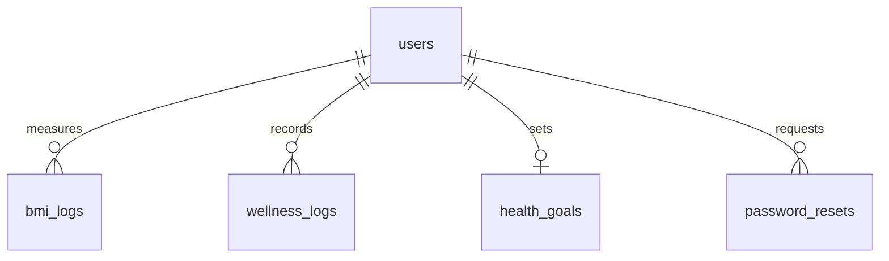
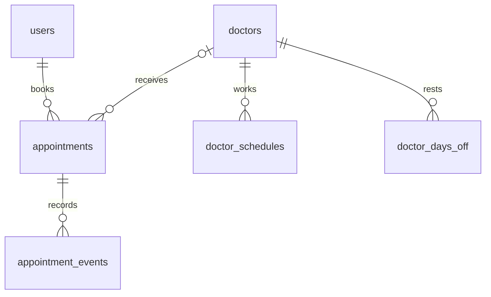

# Kiến trúc HealthConnect

## Luồng ứng dụng

Trình duyệt gửi GET để xem trang, POST để thay đổi dữ liệu. File PHP nạp bootstrap (session, cấu hình, PDO, CSRF), kiểm tra quyền, truy vấn database rồi render HTML bằng layout. JavaScript bổ sung biểu đồ, chat, menu và cài PWA. Không có frontend server riêng.

Chat dùng JSON: trình duyệt → api/chat.php → Ollama trên máy chủ → lưu hội thoại đúng user → JSON về trình duyệt. RSS dùng HTTPS XML bên ngoài và cache file. Email dùng PHPMailer tới SMTP được cấu hình.

## Phân công theo thư mục

| Vị trí | Trách nhiệm |
|---|---|
| includes/bootstrap.php | Cấu hình riêng, kết nối PDO, session, CSRF, xác thực, escape/sanitize |
| includes/appointments.php | Quy tắc lịch, transaction, khóa chung, kiểm tra sức chứa và nhật ký trạng thái |
| includes/layout.php + assets/css/app.css | Khung giao diện desktop/mobile |
| suc-khoe.php, bmi.php, xuat-du-lieu.php | Dữ liệu sức khỏe theo chủ sở hữu |
| bac-si.php, dat-lich.php, phieu-hen.php | Chọn bác sĩ, đặt lịch, xem/in/xuất phiếu |
| admin/ | Quản trị; luôn kiểm tra role phía PHP |
| includes/news_sync.php | Tải RSS/Atom, làm sạch nội dung, TTL/cache/lock |
| includes/mailer.php | Gửi email bằng PHPMailer, không lộ thông tin bí mật ra trình duyệt |
| manifest.webmanifest, sw.js | Cài PWA và cache tài nguyên công khai |
| database/schema.sql, upgrade_final.sql | Cài mới và nâng cấp có giữ dữ liệu |

## Dữ liệu tài khoản và sức khỏe

## Dữ liệu lịch khám

`appointments.doctor_id` cho phép NULL để giữ lịch cũ. Quan hệ bác sĩ và actor_id trong nhật ký là quan hệ logic, chưa áp foreign key trên dữ liệu lịch sử. Tài khoản còn lịch khám được giữ lại và có thể khóa thay vì xóa. doctors không bị xóa qua UI; dùng active để ngừng nhận lịch. appointment_mutex có một hàng để serialize mọi giao dịch thay đổi lịch ở quy mô đồ án.

Các bảng còn lại: categories → articles; users → articles (tác giả); users → chat_sessions → chat_messages; login_attempts lưu số lần đăng nhập sai theo khóa băm.

## Vì sao khóa trước khi đếm chỗ?

Nếu hai request cùng đếm rồi chèn, cả hai có thể thấy “còn một chỗ”. Mọi đường ghi lịch đều lấy cùng mutex bằng `SELECT ... FOR UPDATE` trong transaction, sau đó đếm/kiểm tra/chèn rồi commit. Request sau chỉ được kiểm tra khi request trước đã xong. Khi mở rộng tải, thay bằng khóa theo bác sĩ/slot và user với thứ tự khóa thống nhất; bản hiện tại ưu tiên tính đúng và dễ giải thích.

## Bảo vệ dữ liệu

- Prepared statements cho giá trị nhập; escape HTML đầu ra; nội dung bài viết theo allowlist.
- POST + CSRF cho thao tác ghi; quyền admin và chủ sở hữu kiểm tra phía PHP.
- Mật khẩu băm, cookie HttpOnly/SameSite, session đổi ID sau login; đổi mật khẩu làm phiên cũ mất hiệu lực.
- Upload giới hạn định dạng/MIME/kích thước và chặn thực thi PHP.
- Cache PWA chỉ chứa file tĩnh công khai. Cache RSS không chứa dữ liệu sức khỏe cá nhân.
- Hệ thống chưa phải hồ sơ bệnh án hay phần mềm phòng khám đã được chứng nhận; dữ liệu mẫu dùng cho học tập.
