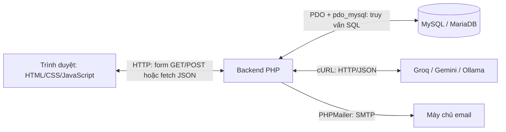
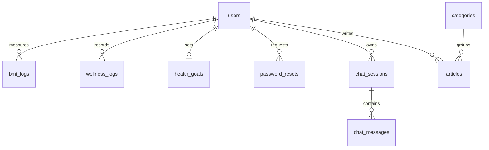
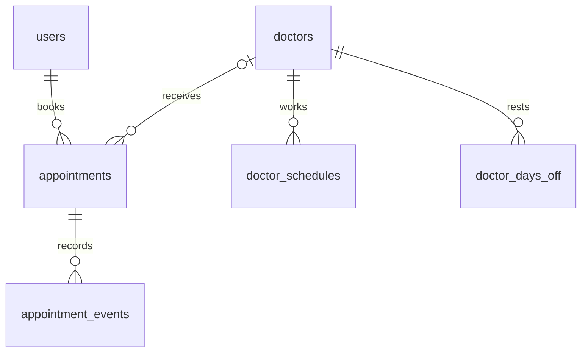

# Mô tả và kiến trúc HealthConnect

Đồ án môn **Lập trình Web và Ứng dụng**: website thông tin y tế, theo dõi sức khỏe cá nhân và đặt lịch khám.

## Người dùng và chức năng

| Vai trò | Chức năng |
|---|---|
| Khách | Đọc/tìm tin, xem bác sĩ, tính thử BMI, hỏi chatbot, đăng ký/đăng nhập |
| Người dùng | Hồ sơ, BMI/biểu đồ, nhật ký/mục tiêu, CSV, đặt lịch/phiếu hẹn/ICS, lịch sử chat |
| Quản trị viên | Thống kê, bài viết/danh mục, bác sĩ/lịch làm việc/ngày nghỉ, lịch khám và tài khoản |

## Frontend, backend và database nối với nhau thế nào?

PHP chạy trên server và trả HTML/JSON về trình duyệt. Trình duyệt không kết nối database trực tiếp. `includes/bootstrap.php` nạp `config.local.php` và tạo kết nối PDO từ host/port/database/user/password; `includes/layout.php` tạo HTML chung, còn CSS/JavaScript xử lý hiển thị và tương tác.

| Thành phần | Công nghệ đang dùng |
|---|---|
| Frontend | HTML, CSS, JavaScript và Bootstrap |
| Backend | PHP thuần, không dùng Laravel |
| Frontend ↔ backend | HTTP: form GET/POST; `fetch()` nhận JSON cho chat/API |
| Backend ↔ database | PDO với driver `pdo_mysql`, truy vấn SQL tới MySQL/MariaDB |
| Web server khi dùng XAMPP | Apache chạy PHP; MySQL là dịch vụ database riêng |

Ví dụ đặt lịch: form ở `dat-lich.php` gửi POST kèm CSRF → PHP kiểm tra tài khoản/dữ liệu → `appt_book()` dùng PDO/transaction để ghi MySQL → chuyển tới `phieu-hen.php` và render kết quả. Chat dùng `fetch()` trong `assets/js/chatbot-php.js` tới `api/chat.php`; key AI chỉ được dùng phía PHP.

## Quy tắc nghiệp vụ

- Đăng ký bằng họ tên, email duy nhất, mật khẩu/xác nhận; mật khẩu dài 8–72 byte, lưu bằng `password_hash`. Hồ sơ bổ sung thông tin sau đăng nhập; đăng nhập kiểm tra vai trò, trạng thái và giới hạn lần sai.
- BMI = cân nặng/(chiều cao mét)²; ngưỡng phân loại trong code là 18,5 / 23 / 27,5. Chiều cao 80–250 cm, cân nặng 20–300 kg; chỉ user đăng nhập mới lưu lịch sử. Nhật ký theo ngày, mục tiêu và CSV thuộc từng tài khoản.
- Mỗi bác sĩ một chỗ/giờ; đặt trong 30 ngày, đúng lịch làm việc và tránh ngày nghỉ. Mỗi user tối đa 3 lịch sắp tới, không trùng giờ giữa hai bác sĩ.
- Lịch có xác nhận, hủy, hoàn thành, vắng và mở lại theo trạng thái/thời gian; phiếu hẹn lưu lịch sử thay đổi. ICS là bản chụp lúc tải, không tự đồng bộ.
- Bài nháp không công khai; ảnh upload được kiểm tra. Không xóa danh mục đang có bài hoặc tài khoản còn lịch khám; có thể khóa tài khoản để giữ lịch sử.

## Dịch vụ tích hợp

- Chat: trình duyệt → `api/chat.php` → Groq/Gemini/Ollama → thêm khuyến cáo → lưu DB hoặc guest session → JSON. Giới hạn 1–2000 ký tự, cách 3 giây theo session; khách giữ tối đa 10 thông điệp. `ai_provider` rỗng dùng Ollama; cloud lỗi không tự đổi provider.
- RSS: PHP tải HTTPS/XML → làm sạch → cache tệp theo TTL và khóa đồng bộ → trang tin/API JSON; bài ngoài mở tại nguồn gốc.
- Quên mật khẩu: PHPMailer gửi mã 6 số; DB giữ bản băm HMAC, session giữ challenge. Mã hạn 15 phút, tối đa 5 lần thử trong cùng trình duyệt và dùng một lần.
- `api/new-chat.php` kiểm tra POST/CSRF và xóa guest history; giao diện đặt `session_id=0`. Phiên DB mới được tạo khi có đáp án hợp lệ tiếp theo.

## Thành phần

| Vị trí trong ứng dụng | Trách nhiệm |
|---|---|
| `includes/bootstrap.php`, `includes/layout.php` | Cấu hình, PDO, xác thực, CSRF, sanitize và giao diện chung |
| `includes/appointments.php` | Quy tắc đặt lịch, transaction, khóa và nhật ký trạng thái |
| `suc-khoe.php`, `bmi.php`, `xuat-du-lieu.php` | Dữ liệu sức khỏe theo chủ sở hữu |
| `bac-si.php`, `dat-lich.php`, `phieu-hen.php` | Bác sĩ, đặt lịch, phiếu/ICS |
| `admin/` | Quản trị, kiểm tra role phía PHP |
| `includes/news_sync.php`, `includes/mailer.php`, `api/` | RSS, SMTP và các endpoint JSON |
| `manifest.webmanifest`, `sw.js` | PWA và cache tĩnh |
| `database/schema.sql`, `database/upgrade_final.sql` | Cài mới và nâng cấp |

## Dữ liệu chính

Schema có 16 bảng; các đường trong ERD thể hiện quan hệ dữ liệu. `appointments.user_id`, `appointments.doctor_id` và `appointment_events.actor_id` là quan hệ logic, chưa có FK trong schema. `doctor_id` cho phép NULL để giữ lịch cũ. `login_attempts` lưu bộ đếm theo khóa băm; `appointment_mutex` có hàng `id=1` dùng để khóa giao dịch.

Mọi đường ghi lịch lấy mutex bằng `SELECT ... FOR UPDATE` trước khi đếm/kiểm tra/chèn rồi commit; lỗi thì rollback. Quy mô đồ án dùng khóa chung để ưu tiên tính đúng; mở rộng tải cần đo đạc và đánh giá khóa theo bác sĩ/khung giờ.

## Bảo vệ dữ liệu

PDO prepared statements, mật khẩu băm, CSRF, role/owner checks, escape/sanitize và kiểm tra ảnh được thực hiện ở server. Đổi mật khẩu làm phiên cũ mất hiệu lực. Cấu hình/key nằm ngoài Git; log lỗi AI che key, giới hạn chống spam hiện theo session. Service Worker không cache PHP/API/uploads. Xem [thư viện và nguồn dữ liệu](THIRD_PARTY.md).

Đồ án dùng dữ liệu giả lập để học tập, không dùng dữ liệu bệnh nhân thật. Thông tin sức khỏe và AI chỉ để tham khảo, không thay thế chẩn đoán/kê đơn hay dịch vụ phòng khám thật.

## Cài đặt và nghiệm thu

Theo [hướng dẫn chạy](../HUONG_DAN.md), [bộ kiểm thử](../../tests/README.md), [demo](DEMO.md) và [checklist trước khi nộp](DEMO.md#checklist-trước-khi-nộp). Ghi rõ phạm vi đã thử: mock, AI/SMTP thật, RSS live, PWA trên thiết bị hoặc hosting HTTPS; kết quả chỉ áp dụng phiên bản và môi trường đã kiểm tra.
